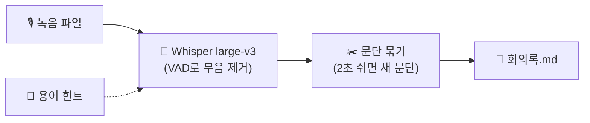

<div align="center">

# 🎙️ 회의록 작성하기 싫어서 만든 녹음본 > text 변환기

**녹음 파일 넣고 → 버튼 한 번 → 회의록 초안 완성**

<br>


</div>

<br>

> [!NOTE]
> 회의 끝나고 녹음 다시 들으면서 받아 적는 거, 이제 안 해도 됩니다.
> 녹음을 시간이 찍힌 원문 기록으로 바꿔 주고, 회의록 양식까지 깔아 줍니다.

<br>

## ✨ 뭐가 되나요

<table>
<tr>
<td width="50%" valign="top">

### 🗣️ 받아쓰기
Whisper `large-v3`로 한국어 회의를 텍스트로 변환
<sub>mp3 · m4a · wav · 대부분의 오디오 포맷</sub>

</td>
<td width="50%" valign="top">

### ⏱️ 문단 + 타임스탬프
2초 넘게 말이 끊기면 새 문단, 문단마다 `[HH:MM:SS]`
<sub>"그 얘기 몇 분쯤이었지?" 바로 찾기</sub>

</td>
</tr>
<tr>
<td valign="top">

### 📝 회의록 양식
요약 · 결정사항 · 할 일 칸이 들어간 `.md` 생성
<sub>노션, 옵시디언, 깃허브에 바로 붙여넣기</sub>

</td>
<td valign="top">

### 🎯 용어 힌트
사람 이름, 팀명, 약어를 미리 알려주면 인식률 ↑
<sub>"케이피아이" ❌ → "KPI" ✅</sub>

</td>
</tr>
<tr>
<td valign="top">

### ⚡ CPU / GPU
NVIDIA 그래픽카드 있으면 GPU로 빠르게
<sub>없어도 CPU로 돌아감</sub>

</td>
<td valign="top">

### 🖥️ 웹 + 터미널
브라우저에서 클릭으로, 또는 CLI로 한 줄
<sub>편한 쪽으로</sub>

</td>
</tr>
</table>

<br>

## 🔄 어떻게 돌아가나요



<br>

## 📄 결과물 미리보기

```markdown
# 회의록 - 주간회의.m4a

- 길이: 00:42:17
- 참석자:

## 요약

## 결정사항

## 할 일 (담당 / 기한)

- [ ] 

---

## 원문 기록

**[00:00:03]** 네 그럼 이번 주 회의 시작하겠습니다. 먼저 지난주 KPI부터 보면...

**[00:01:12]** 스프린트 일정은 다음 주 수요일까지로 하고...
```

> [!TIP]
> 위쪽 빈칸(요약 · 결정사항 · 할 일)은 원문 기록 훑어보면서 채우면 끝.
> 처음부터 받아 적는 것보다 훨씬 빠릅니다.

<br>

## 🚀 시작하기

### 1️⃣ 설치

```bash
git clone <이 저장소 주소>
cd Meeting-STT
pip install -r requirements.txt
```

> [!IMPORTANT]
> 첫 변환 때 `large-v3` 모델(**약 3GB**)을 자동으로 받습니다. 한 번만 받으면 끝.
> GPU용 CUDA 라이브러리(cuBLAS, cuDNN)도 `requirements.txt`에 들어 있어서 따로 설치할 필요 없어요.

### 2️⃣ 실행

<table>
<tr>
<th>🖥️ 웹 화면</th>
<th>⌨️ 터미널</th>
</tr>
<tr>
<td valign="top">

```bash
python app.py
```

브라우저가 자동으로 열려요
→ http://127.0.0.1:9999

1. 녹음 파일 올리기
2. CPU / GPU 고르기
3. 용어 힌트 (선택)
4. **변환** → `.md` 다운로드

</td>
<td valign="top">

```bash
# 기본
python transcribe.py 회의.m4a

# 용어 힌트 + GPU
python transcribe.py 회의.m4a \
  --terms 용어.txt --gpu
```

녹음 파일 옆에 `회의.md` 저장
`용어.txt`는 한 줄에 하나씩

</td>
</tr>
</table>

<br>

## 🎯 용어 힌트 잘 쓰는 법

| ✅ 넣으면 좋은 것 | ❌ 안 넣어도 되는 것 |
|:---|:---|
| 사람 이름 · `김민수`, `박지영` | 흔한 단어 · `회의`, `일정` |
| 팀/제품명 · `그로스팀`, `스마트오더` | 일반 동사, 형용사 |
| 영어 약어 · `KPI`, `OKR`, `API` | 50개 넘는 긴 목록 |

```text
김민수, 박지영, 그로스팀, 스마트오더, KPI, 스프린트, 리텐션
```

💡 **10~30개**가 적당 · 결과에서 틀린 단어 보이면 다음에 추가

<br>

## ⚡ 얼마나 걸리나요

| 장치 | 1시간 녹음 기준 (대략) |
|:---:|:---:|
| 🟢 **GPU** (RTX 2070급) | 몇 분 |
| 🟡 **CPU** | 녹음 길이의 1~3배 |

<br>

## 🛠️ 문제 해결

<details>
<summary><b>❗ <code>Cannot find empty port</code></b></summary>
<br>

앱이 이미 켜져 있어요. 기존 터미널에서 `Ctrl+C`로 끄거나, `app.py` 맨 아래 `server_port`를 바꾸세요.

</details>

<details>
<summary><b>❗ <code>cublas64_12.dll is not found</code></b></summary>
<br>

GPU용 CUDA 라이브러리가 없어요.

```bash
pip install -r requirements.txt
```

다시 실행하거나, 일단 **CPU**로 변환하세요.

</details>

<details>
<summary><b>❗ <code>unexpected keyword argument 'metadata_errors'</code></b></summary>
<br>

PyAV 버전이 너무 최신이에요 (15 이상은 faster-whisper와 안 맞음).

```bash
pip install av==14.2.0
```

</details>

<br>

## 📁 파일 구성

```
📦 Meeting-STT
 ┣ 📜 transcribe.py      받아쓰기 로직 + CLI
 ┣ 📜 app.py             Gradio 웹 화면
 ┣ 📜 requirements.txt   의존성
 ┗ 📜 README.md
```

<br>

## 🗺️ 로드맵

- [x] 한국어 받아쓰기 + 타임스탬프
- [x] 회의록 양식 `.md` 생성
- [x] 웹 UI + CLI
- [x] GPU 지원
- [ ] 🤖 LLM으로 요약 · 결정사항 · 할 일 자동 채우기
- [ ] 📝 내가 쓴 메모랑 녹음 대조
- [ ] 👥 화자 구분 (누가 말했는지)
- [ ] 📂 여러 파일 한 번에 변환

<br>

<div align="center">

**회의는 해도 회의록은 쓰기 싫은 모든 분들께** 🫡

<sub>Built with <a href="https://github.com/SYSTRAN/faster-whisper">faster-whisper</a> & <a href="https://gradio.app">Gradio</a></sub>

</div>
